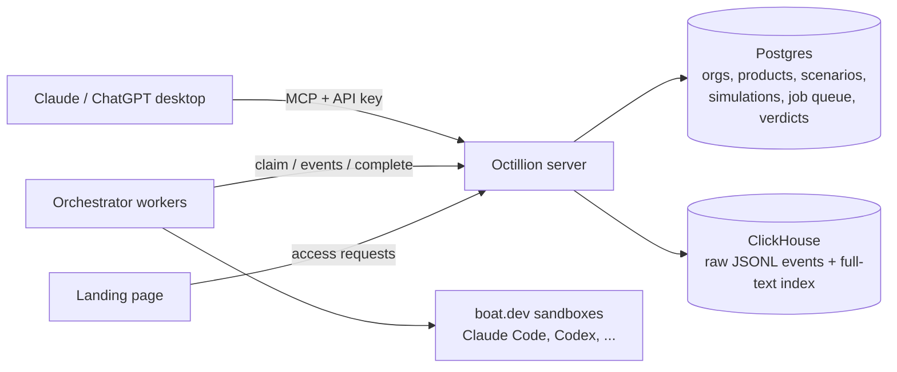

# Octillion

**Do AI coding agents pick your developer tool?**

Developer-tool companies configure their product context (names, package names, competitors) and realistic coding
scenarios. Octillion's orchestrator runs long-lived, sandboxed coding sub-agents (Claude Code, Codex, ...) on those
tasks across models, stores every raw JSONL transcript in ClickHouse, and scores each run:

| Verdict | Meaning |
|---|---|
| `adopted` | an agent action installed or imported one of the product's packages |
| `recommended` | the agent's own prose picked it ("I'll use X", "I recommend X") |
| `mentioned` | named, but not chosen |
| `competitor` | a configured competitor was recommended or adopted instead |
| `none` | no tracked product came up (usually: the agent built it itself) |

Customers use it from **Claude desktop and ChatGPT desktop** through an MCP connector with an interactive dashboard.
It covers configuring products and scenarios, launching simulations, viewing the visibility report (hit rate with
Wilson 95% intervals, share of voice, by model, by scenario, trend) and reading the transcript evidence behind each
verdict.



## Quick start

```bash
npm install
npm run smoke          # end-to-end test (embedded Postgres, no Docker needed)

cp .env.example .env
npm run stack:up       # Postgres + ClickHouse
npm run smoke          # same test on the real stack
npm run demo:seed      # fictional demo org with 2 weeks of scored sessions; prints an API key
npm run dev            # http://127.0.0.1:3333 (landing page) + /preview/get_visibility_report?key=<key>
```

## Onboarding a customer

```bash
npm run access:list                     # who asked for access on the landing page
npm run org:create -- "Acme Inc"        # prints the API key (once) and the connector URL
```

Give them the connector URL `https://<host>/mcp/<api key>`:
- **Claude:** Settings → Connectors → *Add custom connector*. On Team/Enterprise plans an owner adds it once for the org.
- **ChatGPT:** add a custom MCP server and choose no authentication. Business, Enterprise and Edu workspaces need an admin to allow custom MCP.

Clients that can send headers can use `POST /mcp` with `Authorization: Bearer <api key>` instead.
Then they just talk to it: *"Add our product Acme Queue (npm @acme/queue, competitors BullMQ and Inngest), write 5
realistic scenarios where a developer would need a job queue, and run a simulation."*

## MCP tools

| Tool | Does |
|---|---|
| `list_products`, `get_product` | Products, configured context, scenarios with hit rates, warnings (e.g. a prompt that names the product) |
| `save_product` | Create/update product context: aliases, packages, domains, competitors |
| `save_scenarios` | Add/edit/retire scenarios (`expectation`: `recommend` or `avoid`) |
| `run_simulation` | Queue scenarios × models × repeats (default 3) as agent sessions |
| `list_simulations`, `get_simulation`, `cancel_simulation` | Progress, scenario × model matrix, sessions |
| `get_visibility_report` | Hit rate (+95% CI), adoption, losses, share of voice, by model/scenario, daily trend |
| `get_agent_session`, `get_session_transcript` | Verdict evidence and the raw transcript, paged |
| `search_transcripts` | Full-text search over the org's transcripts |

Every query is scoped to the API key's organization (tested in `npm run smoke`).

## Orchestrator worker API

Authenticated with `Authorization: Bearer $OCTILLION_WORKER_TOKEN`. `agent_sessions` is the queue.

| Endpoint | Body | Returns |
|---|---|---|
| `POST /api/worker/claim` | `{worker_id, limit?, models?, harness?}` | `{jobs: [{session_id, prompt, repo_url, model, harness, ...}]}` |
| `POST /api/worker/sessions/:id/events` | JSONL (`application/x-ndjson`) or `{events: [...]}` | `{appended, last_seq}`; counts as a heartbeat |
| `POST /api/worker/sessions/:id/heartbeat` | – | 204 |
| `POST /api/worker/sessions/:id/complete` | `{status, error_message?, sandbox_id?, tokens_in?, tokens_out?, cost_usd?, metadata?}` | the score |

Jobs carry only the task. The sub-agent never learns which company is asking. Events are stored verbatim, with
`seq`/`ts` filled in when missing. The scorer understands Claude Code / Amp / Cursor stream-json, Codex
`exec --json`, Gemini CLI, OpenCode, and a plain `{type: "assistant_message" | "tool_call" | "file_edit", ...}`
format. Send a post-run `git diff` as a `file_edit` event, because Codex's stream doesn't include file contents.
Sessions with no heartbeat for `OCTILLION_LEASE_MINUTES` (30) are timed out. A reference worker using boat.dev
sandboxes lives in [`orchestrator/`](orchestrator/README.md).

## Deploy

`Dockerfile` runs the server (`HOST=0.0.0.0`, port 3333, `/healthz`). It needs `DATABASE_URL`, `CLICKHOUSE_URL`
(plus credentials), `OCTILLION_WORKER_TOKEN` and `PUBLIC_URL`, and must sit behind TLS. The schema is idempotent
and applied on boot.

## Layout

```
src/http.ts          landing page, access requests, /mcp (API key), /api/worker, dev preview
src/server.ts        MCP tools + dashboard resource; model-readable summaries
src/queries.ts       org-scoped reads/writes: products, scenarios, simulations, report
src/worker.ts        job queue: claim, append, complete + score, stale sweep
src/scoring.ts       transcript -> verdict, winner, evidence
src/transcripts.ts   raw JSONL store: ClickHouse (prod) or Postgres (dev); search
src/auth.ts          orgs, hashed API keys, worker token
src/ui/widget.html   the dashboard (single file, no build step)
public/index.html    landing page
orchestrator/        reference sandbox worker (boat.dev)
scripts/             smoke test, org:create, access:list, demo:seed, db:reset
```

## Known gaps

- **Auth is an API key per org, sent in the URL path or as a bearer header.** Next step: OAuth (e.g. WorkOS AuthKit
  with DCR/CIMD), which both Claude and ChatGPT support natively, with per-user identity.
- **Scoring is deterministic** (names, packages, install commands, imports). An LLM judge and a "built it
  themselves" bucket are next. Partial-word and negation handling is heuristic.
- **No billing, quotas or scheduled re-runs yet.** Spend is capped by `OCTILLION_MAX_SESSIONS_PER_RUN` per launch.
