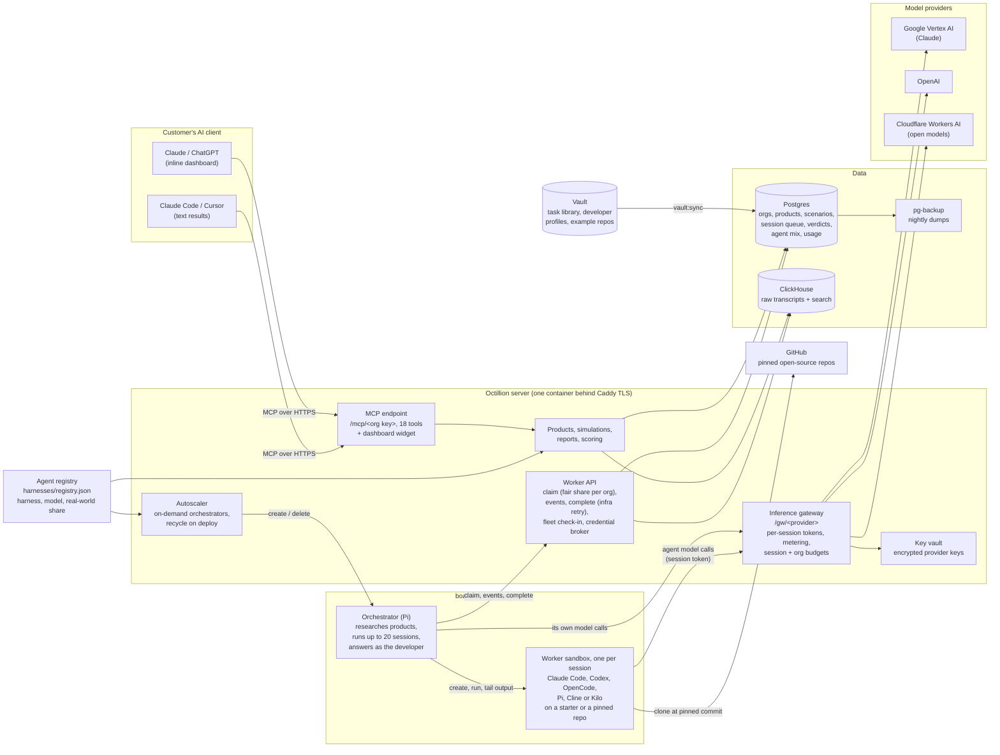

# Octillion

**APO — Agentic Preference Optimization for developer tools.**

SEO got you found by people. APO gets you picked by agents.

> Continues [SoumilB7/Octillion](https://github.com/SoumilB7/Octillion), where the project started; this repository
> carries its full history and is where development happens now.

## What is APO?

Coding agents (Claude Code, Codex, Cursor, OpenCode, ...) now choose the database, the queue and the auth library
while they work, and the developer accepts the diff. **Agentic Preference Optimization** is the practice of measuring
and improving how often those agents choose your product during real work: installing your package, importing your
SDK, or recommending you to the developer.

| | Who decides | The win | What you measure |
|---|---|---|---|
| **SEO** | a person scanning search results | a click to your site | rankings and traffic |
| **GEO** | a chatbot answering a question | a mention or citation | mentions in chat replies |
| **APO** | a coding agent in the middle of a task | your package wired into the code | adoption in real agent transcripts |

Octillion is the APO platform. It runs the APO loop:

1. **Profile**: from a pitch, website and docs, build the product profile (real package names, competitors) and
   target developer personas.
2. **Pose blind problems**: realistic coding tasks that never name the product or a competitor.
3. **Run the real agent mix**: sandboxed coding agents in proportion to developer usage work each task until the
   code is really done, with a simulated developer answering their questions.
4. **Score, fix, re-run**: every run gets a verdict with transcript evidence; the customer improves docs, examples,
   SDK or packaging, and re-runs the same tasks to prove preference moved.

Octillion never pays for placement, injects prompts or touches the models. The headline APO number is the
**preference rate** (reported as the hit rate): the share of runs where an agent adopted or recommended the product.

## How it works

Developer-tool companies configure their product context (names, package names, competitors) and realistic coding
scenarios. Octillion's orchestrator runs long-lived, sandboxed coding sub-agents (Claude Code, Codex, ...) on those
tasks across models, stores every raw JSONL transcript in ClickHouse, and scores each run:

| Verdict | Meaning |
|---|---|
| `adopted` | an agent action installed or imported one of the product's packages |
| `recommended` | the agent's own prose picked it ("I'll use X", "I recommend X") |
| `mentioned` | named, but not chosen |
| `competitor` | a configured competitor was recommended or adopted instead |
| `none` | no tracked product came up (usually: the agent built it itself) |

**Representative by design.** Worker agents come from a versioned registry (`harnesses/registry.json`). Each entry
pins a harness, a model and a sandbox image, and carries a weight: its share of real-world developer usage, with
sources. By default a run samples agents in those proportions. The report shows per-agent results and an
adoption-weighted hit rate.

**Simulated developers.** The orchestrator is built on [Pi](https://pi.dev). When a sub-agent stops to ask
something, the orchestrator answers in character as a developer profile from the curated vault (role, stack,
constraints), then resumes it. It stays blind to the customer's product.

Customers use it from **Claude and ChatGPT** through an MCP connector with an interactive dashboard, and from
**Claude Code, Cursor** and other MCP clients as text.
It covers configuring products and scenarios, launching simulations, viewing the visibility report (hit rate with
Wilson 95% intervals, share of voice, by model, by scenario, trend) and reading the transcript evidence behind each
verdict.



## Quick start

```bash
npm install && npm run orchestrator:install   # server + orchestrator (Pi) deps
npm run typecheck      # server and orchestrator
npm run smoke          # end-to-end test (embedded Postgres, no Docker needed)

cp .env.example .env
npm run stack:up       # Postgres + ClickHouse
npm run smoke          # same test on the real stack
npm run demo:seed      # fictional demo org with 2 weeks of scored sessions; prints an API key
npm run dev            # http://127.0.0.1:3333 (landing page) + /preview/get_visibility_report?key=<key>
```

## Onboarding a customer

```bash
npm run vault:sync                      # pull developer profiles + task library (VAULT_URL or VAULT_DIR)
npm run access:list                     # who asked for access on the landing page
npm run org:create -- "Acme Inc"        # prints the API key (once) and the connector URL
```

Give them the connector URL `https://<host>/mcp/<api key>`:
- **Claude:** Settings → Connectors → *Add custom connector*. On Team/Enterprise plans an owner adds it once for the org.
- **ChatGPT:** add a custom MCP server and choose no authentication. Business, Enterprise and Edu workspaces need an admin to allow custom MCP.
- **Claude Code:** `{"mcpServers": {"octillion": {"type": "http", "url": "https://<host>/mcp/<api key>"}}}` in `.mcp.json`.
- **Cursor and other IDE hosts:** paste the URL into the MCP settings and enable the tools. They show text results, not the dashboard.

Clients that can send headers can use `POST /mcp` with `Authorization: Bearer <api key>` instead.
Then they just talk to it. The first prompt can be *"Get me started with Octillion"*: the `get_started` tool (listed
first) answers with the account's one next step. Or go straight to it: *"Onboard my product: Acme Queue,
https://acme.dev, https://docs.acme.dev. It is a job queue for Node."*

A connected client that never calls a tool shows up in the server log, not in analytics: every `/mcp` request writes
one line (`mcp POST 200 org=<slug> rpc=tools/call:<tool> <ms> ua="<client>"`, never the key), including bad keys (401).

## Walkthrough: first report in three prompts

Recorded against production with headless Claude Code in an empty workspace, on an example product (Resend, an email
API). Full transcript and numbers: [docs/walkthrough-claude-code.md](docs/walkthrough-claude-code.md).

```bash
claude -p "<prompt>" --continue --mcp-config .mcp.json --strict-mcp-config --allowedTools "mcp__octillion"
```

| Prompt | What happens | Time |
|---|---|---|
| "Get me started with Octillion." | `get_started`: a welcome and the next step for this account | 4 s |
| "Onboard my product: Resend, https://resend.com, https://resend.com/docs. It is an email API for developers." | `onboard_product`: research builds the product profile (package, domains, competitors), 2 developer personas and 5 coding tasks (one is a control where no tool should be added), then launches the first simulation | 2 min 26 s |
| "Show my visibility report." | `get_visibility_report`: hit rate, losses to competitors, share of voice, by task and by agent, with the evidence one prompt away | after the 15 min simulation |

That run was 30 agent sessions for $20.98 of model spend (the orchestrator's share was about $0.51). Re-scored with
the current scorer, agents picked the product in 14 of 20 completed email-task sessions and a competitor in 6, and
every one of the 5 inbound-email sessions went to the same competitor: the clearest gap. (The report first said 4 of
20; reading the transcripts exposed scoring errors, since fixed, and the walkthrough keeps both versions.) Small runs
like this are directional, not a benchmark.

## MCP tools

| Tool | Does |
|---|---|
| `get_started` | Listed first. What Octillion does and the account's one next step (onboard, check onboarding, run, check progress, read the report) |
| `onboard_product`, `get_onboarding` | Research a product from a description, website and docs link: profile, competitors, personas and tasks, then a first simulation; progress and results of that research |
| `list_products`, `get_product` | Products, configured context, scenarios with hit rates, warnings (e.g. a prompt that names the product) |
| `save_product` | Create/update product context: aliases, packages, domains, competitors |
| `save_scenarios` | Add/edit/retire scenarios (`expectation`: `recommend` or `avoid`) |
| `run_simulation` | Default: adaptive. Each scenario starts with `OCTILLION_DEFAULT_SAMPLES` (3) sessions per developer profile and is sampled further until its hit rate is stable (95% interval within ±20 points) or it has had `max_samples` (`OCTILLION_MAX_SAMPLES`, 20) sessions, so scenarios where agents agree stop early and contested ones get more. `samples` alone gives a fixed-size run. Agents are mixed by adoption weight. Explicit: `agents`/`models` × `repeats`. Optional developer `profiles`. Capped per run (`OCTILLION_MAX_SESSIONS_PER_RUN`) and per organization per month (`OCTILLION_ORG_MONTHLY_BUDGET_USD`) |
| `list_agents` | A developer population's coding-agent mix (whole sandboxes out of 20), sources, and the available populations |
| `list_developer_profiles`, `browse_task_library` | Curated developer personas and real-world tasks from the vault |
| `list_simulations`, `get_simulation`, `cancel_simulation` | Progress, scenario × model matrix, sessions |
| `get_visibility_report` | Hit rate (+95% CI), adoption, losses, share of voice, by model/scenario, daily trend |
| `get_agent_session`, `get_session_transcript` | Verdict evidence and the raw transcript, paged |
| `search_transcripts` | Full-text search over the org's transcripts |

Every query is scoped to the API key's organization (tested in `npm run smoke`).

## Orchestrator worker API

Authenticated with `Authorization: Bearer $OCTILLION_WORKER_TOKEN`. `agent_sessions` is the queue.

| Endpoint | Body | Returns |
|---|---|---|
| `POST /api/worker/claim` | `{worker_id, limit?, models?, harness?}` | `{jobs: [{session_id, prompt, repo_url, model, harness, ...}]}` |
| `POST /api/worker/sessions/:id/events` | JSONL (`application/x-ndjson`) or `{events: [...]}` | `{appended, last_seq}`; counts as a heartbeat |
| `POST /api/worker/sessions/:id/heartbeat` | – | 204 |
| `POST /api/worker/sessions/:id/complete` | `{status, error_message?, sandbox_id?, tokens_in?, tokens_out?, cost_usd?, metadata?}` | the score |

Jobs carry only the task. The sub-agent never learns which company is asking. Events are stored verbatim, with
`seq`/`ts` filled in when missing. The scorer understands Claude Code / Amp / Cursor stream-json, Codex
`exec --json`, Gemini CLI, OpenCode, and a plain `{type: "assistant_message" | "tool_call" | "file_edit", ...}`
format. Send a post-run `git diff` as a `file_edit` event, because Codex's stream doesn't include file contents.
Sessions with no heartbeat for `OCTILLION_LEASE_MINUTES` (30) are timed out. A reference worker using boat.dev
sandboxes lives in [`orchestrator/`](orchestrator/README.md).

## Developer populations

The coding-agent mix lives in Postgres as **developer populations**: `developer_populations` holds name, sources,
as-of date, sandbox unit and the min-one switch, and `developer_population_agents` holds each agent's market share
and pause switch.

- **Default population.** It is `global`, seeded once from `harnesses/registry.json`. After that the database is
  the source of truth.
- **Other populations.** You can define others, such as enterprise developers, and pass one to
  `run_simulation` / `get_visibility_report` / `list_agents` as `population`.
- **Agent definitions** (images, versions, adapters) stay in the registry file.

```bash
npm run population -- show                      # mix in whole sandboxes out of 20
npm run population -- share global codex/default 0.21
npm run population -- pause global cursor/auto "no credentials yet"   # resume global cursor/auto
npm run population -- create enterprise "Enterprise developers" --from global
```
Admin API: `/api/admin/populations[/:slug[/agents/:agent]]` with `OCTILLION_ADMIN_TOKEN`.

## Orchestrators and the pod fleet

The orchestrator ([`orchestrator/`](orchestrator/README.md)) is [Pi](https://pi.dev) with an Octillion extension.
It runs one Pi session per job, restricted to Octillion tools: start the worker, wait for its turn, reply as the
developer, and finish.

- **Pods.** Each orchestrator runs up to **20 warm worker pods**. A pod is a container from
  `orchestrator/images/Dockerfile.<harness>`, with the harness version pinned. A pod is recycled after every
  session, so each run starts clean. Provider keys are injected per exec. The worker token and the orchestrator's
  LLM key never enter a pod.
- **Fleet mix.** Orchestrators check in with `POST /api/worker/fleet`. The server apportions the total fleet,
  live orchestrators × 20, across harnesses by real-world usage and deals each orchestrator an even share.
  10 orchestrators make 200 pods; Claude Code at 40% gets 80 of them, 8 per orchestrator. Every runnable harness
  keeps at least one pod. Run `npm run fleet:status` to see the live plan.
- **Sampling.** Sessions are sampled with the same weights, so pod capacity matches demand. Only harnesses with a
  worker adapter are sampled. `list_agents` reports how much of real usage that covers.

```bash
cd orchestrator && npm install
OCTILLION_URL=https://<host> OCTILLION_WORKER_TOKEN=... ANTHROPIC_API_KEY=... OPENAI_API_KEY=... \
ORCHESTRATOR_ID=orch-1 RUNNER=pool POD_CAPACITY=20 npm start
```

## Deploy

`Dockerfile` runs the server (`HOST=0.0.0.0`, port 3333, `/healthz`). It needs `DATABASE_URL`, `CLICKHOUSE_URL`
(plus credentials), `OCTILLION_WORKER_TOKEN` and `PUBLIC_URL`, and must sit behind TLS. The schema is idempotent
and applied on boot.

## Layout

```
src/http.ts          landing page, access requests, /mcp (API key), /api/worker, dev preview
src/server.ts        MCP tools + dashboard resource; model-readable summaries
src/queries.ts       org-scoped reads/writes: products, scenarios, simulations, report
src/worker.ts        job queue: claim, append, complete + score, stale sweep
src/scoring.ts       transcript -> verdict, winner, evidence
src/transcripts.ts   raw JSONL store: ClickHouse (prod) or Postgres (dev); search
src/auth.ts          orgs, hashed API keys, worker token
src/agents.ts        worker-agent registry, adoption-weighted sampling
src/vault.ts         sync developer profiles + task library from the vault
src/ui/widget.html   the dashboard (single file, no build step)
public/index.html    landing page
orchestrator/        Pi-based orchestrator agent + boat.dev worker runtime
harnesses/           worker-agent registry (versions, images, adoption weights + sources)
vault/               vault format + example
scripts/             smoke test, org:create, access:list, demo:seed, db:reset
```

## Known gaps

- **Auth is an API key per org, sent in the URL path or as a bearer header.** Next step: OAuth (e.g. WorkOS AuthKit
  with DCR/CIMD), which both Claude and ChatGPT support natively, with per-user identity.
- **Scoring is deterministic** (names, packages, install commands, imports). An LLM judge and a "built it
  themselves" bucket are next. Partial-word and negation handling is heuristic.
- **No billing, quotas or scheduled re-runs yet.** Spend is capped by `OCTILLION_MAX_SESSIONS_PER_RUN` per launch.
