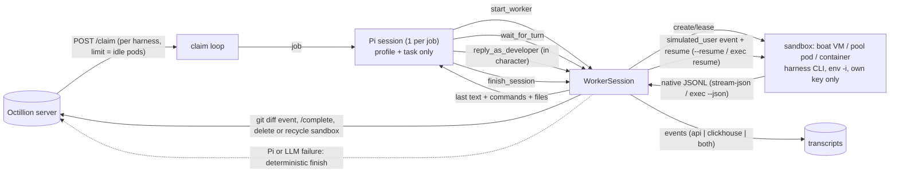

# Octillion orchestrator

The orchestrator claims queued simulation sessions from the Octillion server. Each session runs a coding-agent CLI
(the "sub-agent": Claude Code, Codex, ...) headless in a throwaway sandbox, and streams its native JSONL to the transcript store.
When the sub-agent stops to ask the developer something, an orchestrator agent built on **[Pi](https://pi.dev)**
answers in character as that developer, and the same sub-agent conversation resumes.

Two entry points share the same deterministic core:

| entry | what it does |
|---|---|
| `npx tsx orchestrator/pi-octillion/main.ts` | **Orchestrator agent.** Pi (embedded through its SDK) plays the developer for up to `max_user_turns` replies. |
| `npx tsx orchestrator/worker.ts` | **Deterministic worker, no LLM.** It runs the harness once and finishes. The Pi path falls back to this. |

```
orchestrator/
  pi-octillion/   Pi extension package: index.ts (tools), prompt.ts (system prompts), main.ts (host), skills/
  core/           config, sessions, sandbox runners (boat, docker, local), warm pod pool, transcript sink, usage, boat client
  harnesses/      adapters.ts: per-harness launch/resume argv, session-id extraction, turn digest
  fleet/          plan.ts (standalone usage-proportional plan, owned by fleet), status.ts (pods per harness)
  images/         Dockerfile.<harness> per harness (maintained separately)
  worker.ts       claim loop + deterministic run
  .pi-upstream/   Pi source clone, for reference only (gitignored)
```

## Architecture



Per job: claim → open a sandbox (boat VM, or a leased pool pod) → launch the harness with the scenario prompt,
verbatim on stdin → stream its JSONL → **simulated-developer loop**: Pi reads the sub-agent's last message. If the
sub-agent is waiting on the user (a question, a choice, a confirmation, or "should I proceed?"), Pi writes the developer's
reply. The reply is emitted as `{"type":"simulated_user","turn":n,"content":...}`, and the same harness conversation
resumes with it, in the same sandbox and workdir. This repeats up to `job.max_user_turns` (default 5) →
`{"type":"file_edit","name":"git diff","content":...}` → `/complete` → the sandbox is deleted (boat) or recycled (pool).

### Pi embedding: SDK in-process, one Pi session per job

Pi ([earendil-works/pi](https://github.com/earendil-works/pi), MIT) is used through its npm SDK,
`@earendil-works/pi-coding-agent@1.1.0`. The reference clone is pinned at
**`42a3497d03ad17e308a2299fa824727894f2c0ec`** (2026-10-09), and the package version matches it. It is declared in
`orchestrator/package.json` and installed in `orchestrator/node_modules`, not in the root package.json.

- **Why the SDK and not RPC or print mode.** The tools need direct access to live in-process state: sandboxes,
  streams, timers and the transcript sink. RPC would add a child process and a wire protocol and buy nothing.
  `createAgentSession()` gives full control: the tool allowlist, the system prompt, in-memory settings and sessions,
  and a model runtime isolated from `~/.pi`.
- **Why one Pi session per job, not one Pi managing N workers.** Each developer profile stays in its own context,
  so profiles can't bleed between jobs. Context stays small: about 2-6k tokens per turn, with no compaction. Failures
  are isolated per job, and the fallback is per job. Concurrency is plain `Promise` parallelism in one Node process,
  with no LLM attention split across workers.
- **What Pi can do.** It gets only the pi-octillion tools: `start_worker`, `wait_for_turn`, `reply_as_developer`,
  `finish_session`. `claim_jobs` is added in manual CLI mode. Pi's built-in read/bash/edit/write tools are off, and so is
  the discovery of extensions, skills, context files and `~/.pi` settings. The model runtime uses its own temp `auth.json` and `models.json`.
- **Guards in the tools, not the prompt.** The tools enforce `max_user_turns`, "reply only when the run ended
  cleanly and is resumable" and "finish once". The status sent to `/complete` is computed from the harness result. Pi's
  `status` and `note` are recorded only as `orchestrator_status` / `orchestrator_note` metadata.
- **Deterministic fallback.** If the Pi setup fails, the LLM errors after retries, Pi exceeds the session budget, or Pi ends
  without finishing, the host finishes the session itself. If Pi never started the worker, the host runs the job
  deterministically. A job is never lost to an LLM failure. `/complete` metadata records `orchestrator` (`pi`,
  `pi+fallback` or `fallback`), `orchestrator_error`, `orchestrator_cost_usd`, `orchestrator_tokens_*` and
  `orchestrator_llm_calls`.

Manual and debug use from the Pi CLI: `pi -e ./orchestrator/pi-octillion --no-builtin-tools --no-context-files`. This is
manager mode, with `claim_jobs` and the `octillion-orchestrator` skill.

### The simulated developer: blindness

`pi-octillion/prompt.ts` exports `SIMULATED_DEVELOPER_SYSTEM_PROMPT` (the founder can tune it),
`ORCHESTRATOR_SYSTEM_PROMPT` (the tool protocol plus those rules) and `jobPrompt()`. Pi answers as `job.profile`: role,
experience, company size, stack, constraints, tone and instructions. With no profile, it answers as a neutral
"experienced developer who wants the task done; answers briefly". The prompt requires the following:
- It never introduces a product, vendor, library or service name that the sub-agent or the task did not already mention.
- It chooses between offered options only when the profile's constraints decide it. Otherwise it says "your call".
- It writes one to three short chat sentences, and never mentions simulation, AI or evaluation.
- It treats "done" or "progress" messages, and optional offers made after finishing, as **not waiting**.

Pi sees only the profile, the task prompt and the sub-agent's output. That output is the last text (up to 8k chars) plus up to
25 commands and 40 files. It never sees the customer, the product, or any org, product, session or simulation ids. Tool results carry only a
random `w_xxxxxxxx` handle. The orchestrator key (`ORCHESTRATOR_API_KEY`) is used only in the host process. It is never
passed to a sandbox. The tests checked transcripts and sandbox traffic for it.

### Harness adapters (`harnesses/adapters.ts`)

One `HarnessAdapter` per registry `harness` id. Each adapter defines the binary, the env for that harness's key, `launchArgv`, `resumeArgv`,
and a digest that extracts `{lastText, commands, files, sessionId, error}` from the JSONL.

| harness | launch (input on stdin) | resume (reply on stdin) | id from |
|---|---|---|---|
| `claude-code` | `claude -p --output-format stream-json --verbose --model M --dangerously-skip-permissions [--max-budget-usd N]` | `claude -p --resume <session_id> ...same flags` | `system/init.session_id` |
| `codex` | `codex exec --json --model M --dangerously-bypass-approvals-and-sandbox --skip-git-repo-check --color never -C <workdir> -` | `codex exec resume <thread_id> --json --model M --dangerously-bypass-approvals-and-sandbox --skip-git-repo-check -` | `thread.started.thread_id` |

The flags were checked against the installed CLIs (claude 2.1.296 `--help`, codex 0.162 `exec resume --help`).
- **Claude Code:** `--no-session-persistence` is dropped, because resume needs the stored session.
- **Codex:** `--ephemeral` is dropped, because it disables the rollout file that resume reads. `exec resume` has no `-C` or `--color`, so the runner starts it in the workdir.
- **Other harnesses:** `cursor-agent`, `gemini`/`gemini-cli`, `agy`, `copilot`, `opencode`, `amp`, `pi`, `aider`, and any other id in `harnesses/registry.json`, throw
  "not yet supported" stubs. The pool never claims jobs for harnesses without an adapter and a key.

Usage: Claude's `result` events are **summed across runs**, because each resume reports its own usage and cost. Codex sums
`turn.completed.usage` and reports no cost.

## Sandboxes (`RUNNER`)

| runner | sandbox | notes |
|---|---|---|
| `boat` (default) | one fresh [boat.dev](https://docs.boat.dev) VM per session | REST API, see below |
| `pool` | warm per-harness Docker pods, sized from the server's global fleet plan | see "Warm pod pool" |
| `docker` | one long-lived container per session from `SANDBOX_IMAGE` | `docker exec` per run |
| `local` | host CLI in a temp dir | dev only, no isolation |

Every runner exposes the same `Sandbox` interface: `runTurn(argv, stdin)`, `diff()`, `kill()` and `cleanup()`.
Resumes run in the same sandbox. Docker and pool runs use `docker exec -u agent ... env -i <image env without OCTILLION_*> <KEY>="$KEY"`.
Key values travel as `docker exec -e NAME`, so they never appear in argv or the container env.

### boat.dev runner

Base URL `https://boat.dev/api/v1`, `Authorization: Bearer $BOAT_API_KEY` ([API v1](https://docs.boat.dev/api/v1)).

1. `POST /sandboxes {type, ttlSeconds, noEnv: true, snapshots: false}` with an `Idempotency-Key`. `noEnv` keeps account
   secrets off the VM ([create](https://docs.boat.dev/api/reference/sandboxes/create-sandbox)). Then poll `GET /sandboxes/{id}` until the state is `ready`, `idle` or `running`.
2. `PUT /files`: the env file and scripts go into `/tmp/octi` (mode 700). `prepare.sh` (a sync exec) creates an unprivileged `agent` user,
   builds a PATH to the preinstalled CLIs, installs the harness env file at `/home/agent/.octi-env` (mode 600), and
   optionally clones the repo into `/home/agent/work`.
3. Each run writes `in-N.txt` and `launch-N.sh`, then `POST /commands {detached: true}` (sync exec caps at 600s). The run is
   `env -i` as `agent`, and its stdout goes to `out-N.jsonl`. The worker follows it with `POST /commands {stream: true}` running
   `timeout 540 tail -n +<line> -F --pid=<pid>`, as NDJSON frames `{"type":"stdout","data":...}`. It reconnects by line number,
   and `GET /commands/{processId}` reports when the run has exited ([exec](https://docs.boat.dev/api/reference/agent/execute-sandbox-command)).
4. Finish: `DELETE /sandboxes/{id}` with `X-Ascii-Confirm-Delete` force-stops the VM and deletes it. If that fails, the worker falls back to `POST /stop {force:true}`.
   The TTL is `MAX_SESSION_MINUTES + BOAT_TTL_MARGIN_MINUTES`, and exec'd work does not extend it.

**Why not Boat's managed `boat prompt` / `POST /prompt` + `GET /events`.**
Boat injects its own system prompt, a `boat` skill and a `computer` MCP server into managed harnesses
([integrated agents](https://docs.boat.dev/integrated-agents)), which breaks blindness. Its events are also a
normalized format, `{type: "prompt"|"response", data: {content, is_streaming, tools: [{use, result}]}}`, with no
Claude `result` usage or cost. We run the stock preinstalled CLI as an isolated user and keep the native stream.

**Costs and limits** ([pricing](https://docs.boat.dev/pricing), 2026-10):

| size | $/hour |
|---|---|
| `small` | 0.018 |
| `default` | 0.036 |
| `large` | 0.072 |
| `xlarge` | 0.20 |

- Billing is per second, and only while running. A 45-minute `default` session costs about $0.03 of VM time.
- The $20/mo plan gives 100 concurrent VMs and 12/60/200 starts per minute/hour/day.
- The trial allows 2 concurrent VMs, and its TTL is at most 2h.
- VMs run in the EU.

Use a `ci`-preset key: `boat api-key create octillion-worker --preset ci --ttl 90d`.

### Warm pod pool (`RUNNER=pool`)

Each orchestrator runs up to `POD_CAPACITY` (≤ 20) warm Docker pods. N orchestrators run N×20 pods, and the
**usage proportions hold globally because the server plans the fleet** (`src/fleet.ts`):

- **Check-in.** At start and every `next_checkin_seconds`, the orchestrator calls `POST /api/worker/fleet {orchestrator_id: ORCHESTRATOR_ID, capacity}`.
  This registers it and acts as its heartbeat. The response's `assignment` (`[{harness, pods, image, version}]`) is this orchestrator's share of the
  global, usage-proportional plan: Claude Code at 40% of 200 pods gets about 80 pods, about 8 per orchestrator. Orchestrators silent for longer than 90s drop out, and the
  server re-deals their pods.
- **Reconcile.** Missing pods are started warm (`docker run -d ... sleep infinity`). Surplus **idle** pods are removed. Surplus busy
  pods are retired when their session ends.
- **Claim per harness.** The limit is that harness's idle pods. One pod is reserved per claimed job. Claims skip harnesses without an
  adapter or provider key, so jobs aren't burned.
- **Run.** Every run goes through `docker exec -u agent` + `env -i`, with only that harness's key. Resumes run in the same pod.
- **Recycle.** After the session, the pod is destroyed and a fresh one is started if the harness is still below target. Every session starts clean.
- **Server unreachable.** The orchestrator keeps its current pool and retries every 10s. With `FLEET_MODE=standalone`, it plans locally with `fleet/plan.ts`'s
  `planFleet(POD_CAPACITY)` from `harnesses/registry.json`.
- **SIGTERM.** The orchestrator calls `DELETE /api/worker/fleet/:id` (a graceful leave), drains, and removes all pods it owns.
- **Pods.** Images are `orchestrator/images/Dockerfile.<harness>`, built with `orchestrator/images/build.sh`. Pods get the docker runner's
  cpu, memory, pids and network limits. Labels are `octillion.pool=1`, `octillion.harness=<h>` and `octillion.pool.owner=<ORCHESTRATOR_ID>`.
  Busy pods are renamed `octi-busy-*`.
- **Status.** `npx tsx orchestrator/fleet/status.ts [--owner ID] [--json]` shows idle and busy pods per harness on this host, against
  the server's global plan (with `OCTILLION_URL` and the token set) or the standalone plan.
- **Boat parity (next).** The same semantics on boat would mean N warm VMs per harness, forked from per-harness named snapshots
  (`from: octillion-<harness>-<version>`, the registry's `image.boat_snapshot`). That is not built yet. Boat VMs are created per session today.

## Transcript sink (`TRANSCRIPT_SINK`)

| mode | behaviour |
|---|---|
| `api` (default) | Harness lines are sent verbatim to `POST /api/worker/sessions/:id/events` (NDJSON, every `FLUSH_INTERVAL_MS`). The server assigns seq and ts. |
| `clickhouse` | Events are inserted directly through the ClickHouse HTTP interface: `INSERT INTO {db}.transcript_events (org_id, product_id, simulation_id, session_id, model, seq, ts, type, text, raw) FORMAT JSONEachRow` with `date_time_input_format=best_effort` and basic auth. `seq` is a per-session counter that continues after `max(seq)` already stored, for example by an earlier attempt. `ts` is ISO. `text` comes from `eventText()`, mirrored from `src/transcripts.ts`. `raw` is the event with seq, ts and type, like the server's `normalize()`. |
| `both` | Both stores, with the **same seq and ts** written into the API copy, so they agree. ReplacingMergeTree dedupes if the server also writes to ClickHouse. |

Heartbeats and `/complete` always go to the API. The server recounts events from the store when it scores.

## Cost note

- Orchestrator LLM calls per session: at most `max_user_turns + 1` decisions. Each decision is 1-2 small model requests (a tool call plus the
  next tool call). Each request carries about 2-6k tokens of context (system prompt, profile, task, last message).
- With `claude-opus-5-5`, a session with no question costs about 4 requests (start → wait → finish). A session with 5 replies costs about 13.
- Per-session cost is recorded in `/complete` metadata as `orchestrator_cost_usd`, using Pi's price table.
- `ORCHESTRATOR_THINKING` (default `low`) maps to Pi's thinking level.
- Boat VM time is about $0.036/h (`default`). Pool pods cost whatever the Docker host costs.

## Env vars

| var | default | notes |
|---|---|---|
| `OCTILLION_URL`, `OCTILLION_WORKER_TOKEN` | `http://localhost:3000`, - | worker API. The token never enters a sandbox or pod |
| `ANTHROPIC_API_KEY`, `OPENAI_API_KEY` | - | harness keys. Each sandbox gets only its harness's key (`CODEX_API_KEY` for codex) |
| `RUNNER` | `boat` | `boat`, `pool`, `docker` or `local` |
| `WORKER_CONCURRENCY` | `2` | parallel sessions for boat, docker and local. For the pool, capacity is the pod count |
| `MAX_SESSION_MINUTES` | `45` | hard kill (all runs + replies), then reported as `timeout` |
| `MAX_USER_TURNS` | `5` | used when a job has no `max_user_turns` |
| `WORKER_ID`, `WORKER_MODELS`, `WORKER_HARNESS`, `MAX_BUDGET_USD` | | as before (`MAX_BUDGET_USD` applies per Claude run) |
| `POLL_INTERVAL_SECONDS` (5), `FLUSH_INTERVAL_MS` (2000), `HEARTBEAT_SECONDS` (60) | | |
| **orchestrator (Pi)** | | |
| `ORCHESTRATOR_PROVIDER` / `ORCHESTRATOR_MODEL` | `anthropic` / `claude-opus-5-5` | any Pi provider and model |
| `ORCHESTRATOR_API_KEY` | `ANTHROPIC_API_KEY` | used only in the host process |
| `ORCHESTRATOR_API_URL` | - | override the provider base URL (gateway, proxy or test mock) through a temp `models.json` |
| `ORCHESTRATOR_THINKING` | `low` | `off`, `minimal`, `low`, `medium` or `high` |
| `ORCHESTRATOR_MAX_RETRIES` | `3` | Pi retries on 429/5xx before the fallback takes over |
| **transcripts** | | |
| `TRANSCRIPT_SINK` | `api` | `api`, `clickhouse` or `both` |
| `CLICKHOUSE_URL`, `CLICKHOUSE_USER`, `CLICKHOUSE_PASSWORD`, `CLICKHOUSE_DATABASE` | -, `default`, -, `octillion` | for `clickhouse` and `both` |
| **pool** | | |
| `FLEET_MODE` | `server` | `server` (global plan from `/api/worker/fleet`) or `standalone` (`planFleet`) |
| `ORCHESTRATOR_ID` | hostname | stable fleet identity. It is also the pod owner label, so leftovers are reaped on restart |
| `POD_CAPACITY` | `20` | pods for this orchestrator (≤ 20). `FLEET_SIZE` is a legacy alias |
| `OCTILLION_REGISTRY` | `harnesses/registry.json` | standalone plan source |
| `POOL_IMAGE_OVERRIDE` | - | dev and test only: one image for every harness |
| **boat** | | |
| `BOAT_API_KEY` | - | required for `RUNNER=boat` |
| `BOAT_API_URL`, `BOAT_SANDBOX_SIZE` (`default`), `BOAT_TTL_MARGIN_MINUTES` (15), `BOAT_READY_TIMEOUT_SECONDS` (300), `BOAT_ORG` | | |
| `BOAT_AGENT_USER` | `agent` | `agent` (fresh unprivileged user, most blind) or `user` (Boat's user with a fresh HOME, has sudo) |
| `BOAT_ON_FINISH` (`delete`), `BOAT_DIFF_MAX_BYTES` (2000000) | | |
| **docker / local** | | |
| `SANDBOX_IMAGE` (`octillion-sandbox:latest`), `DOCKER_NETWORK`, `DOCKER_CPUS` (2), `DOCKER_MEMORY` (4g) | | docker and pool limits |
| `CLAUDE_BIN`, `CODEX_BIN` | | local runner only |

## Run

```bash
cd orchestrator && npm install && cd ..       # Pi SDK (orchestrator/package.json)
export OCTILLION_URL=https://octillion.example.com OCTILLION_WORKER_TOKEN=...
export ANTHROPIC_API_KEY=... OPENAI_API_KEY=...  # harness keys
export ORCHESTRATOR_API_KEY=...                  # Pi's key (optional; defaults to ANTHROPIC_API_KEY)

# orchestrator agent on boat.dev
BOAT_API_KEY=... npx tsx orchestrator/pi-octillion/main.ts

# orchestrator agent on a warm pod pool, server-planned (run N of these on N hosts)
orchestrator/images/build.sh
RUNNER=pool ORCHESTRATOR_ID=orch-eu-1 POD_CAPACITY=20 npx tsx orchestrator/pi-octillion/main.ts
npx tsx orchestrator/fleet/status.ts --owner orch-eu-1

# no LLM: one run per job, no simulated developer
npx tsx orchestrator/worker.ts
```

SIGINT/SIGTERM kills running sandboxes, which are reported as `failed`. In pool mode it also leaves the fleet and removes the pods. A repeated
signal within 3s is ignored, because npx and tsx both forward it. A later second signal exits immediately. A 404 or 409 from `/events` or
`/heartbeat` kills the sandbox and skips `/complete`.

## Security notes

- **Blindness.** A sandbox receives the prompt and replies on stdin, the optional repo, its harness's key and a few neutral
  env vars. It never receives Octillion ids, URLs, tokens, the orchestrator key, customer names, or `OCTILLION_*` image env.
  - On boat, the harness runs as a separate `agent` user under `env -i`. It sees none of Boat's tokens, skills or MCP.
  - Docker and pool runs use `env -i` with the image's neutral env minus `OCTILLION_*`. The other agent's images set
    `OCTILLION_HARNESS`, which the runner strips.
  - The local runner uses an empty `HOME` and `CODEX_HOME`.
- **No customer data in prompts.** Prompts and replies are sent verbatim.
- **Network.** Agents need egress. They run with skip-permissions flags, which are safe only because the VM, pod or container is the sandbox.
  Containers run non-root, with `--cap-drop ALL`, `no-new-privileges` and limits. Never mount the Docker socket. Block 169.254.169.254 and private ranges with `DOCKER_NETWORK`.
- **API keys.** The agent can read its own key, so use scoped, spend-capped keys and rotate them. On boat, the harness env file
  (`/home/agent/.octi-env`, mode 600) stays readable by the agent for all of its runs. The orchestrator key never leaves the host process.

## Verification (local mocks, no live spend)

Everything below ran against local mocks: a mock boat API backed by an Ubuntu 24.04 container, a mock Anthropic Messages SSE
endpoint as Pi's LLM through `ORCHESTRATOR_API_URL`, and fake `claude`/`codex` CLIs. The fake Claude asks a question on its first run
and finishes when resumed.

- **Pi loop.** start_worker → wait (a question is detected) → reply → resume with `claude -p --resume <session_id>` → wait (done) → finish. One `simulated_user` event is sent, the reply reaches the CLI verbatim, the diff event is sent, and status is `completed`.
- **Pi wiring.** Requests used the orchestrator key, the custom base URL, the blindness system prompt and only the four tools.
- **max_user_turns=2.** With an LLM that always replies, the third reply is rejected by the tool, and the session finishes after 2 replies and 3 runs.
- **LLM failure.** On a total failure, the host runs the job deterministically (`orchestrator: fallback`, with `orchestrator_error` recorded). On a failure mid-session, the host finishes the open session (`pi+fallback`).
- **Timeout.** The session deadline kills the VM (DELETE) and reports `timeout`.
- **ClickHouse sink**, against the local ClickHouse 25.12. `both`: API and ClickHouse got the same seq 1..8. `clickhouse`: seq continued 9..16 after the existing rows. The test rows were deleted afterwards.
- **Pool runner (standalone, `POD_CAPACITY=3`).** One fake image was tagged as claude-code and codex with 60/40 weights, so the pool ran 2+1 pods.
  - Claims were per harness, with limit equal to the idle pods.
  - The third claude job got a fresh recycled pod.
  - Codex pod env had no `OCTILLION_*` and no Anthropic key.
  - Resume ran in the same pod.
  - SIGTERM drained every pod.
- **Fleet, 2 orchestrators against the real server** (`npx tsx src/http.ts`, temp PGlite, `scripts/fixtures/registry.json`).
  - With capacity 7+7, the pods summed exactly to the global plan, `{claude-code 7, codex 4, cursor-agent 3}`.
  - After B left gracefully, A re-checked in and matched the 7-pod plan.
  - With A at capacity 3 and B at capacity 7, A's idle pods were scaled down, and a busy surplus pod was kept until its session ended and then retired.
  - After drain, no containers were left and no orchestrators were registered.
- **Not run live.** boat.dev, the real Anthropic API through Pi, and real Claude Code/Codex resume. Codex resume flags were checked with `--help` and a parse-only run.

## Open questions

1. **Thinking level.** Pi maps opus-5-5 effort through Anthropic's managed-effort mechanism. Is `low` enough for good in-character replies, or should we use `medium`?
2. **Reply guard.** Should replies get a deterministic post-check (for example, rejecting proper nouns that the sub-agent didn't mention), on top of the prompt rule?
3. **Pool on boat.** Should the pool run on boat too, using per-harness named snapshots? Today boat VMs are created per session.
4. **Image env.** The other agent's images set `OCTILLION_HARNESS` in their env. We strip it, but it would be cleaner to drop it from the images.
5. **Failed harness runs.** A resumed run that fails marks the session `failed`, even when the first run succeeded. Is that the scoring we want?
